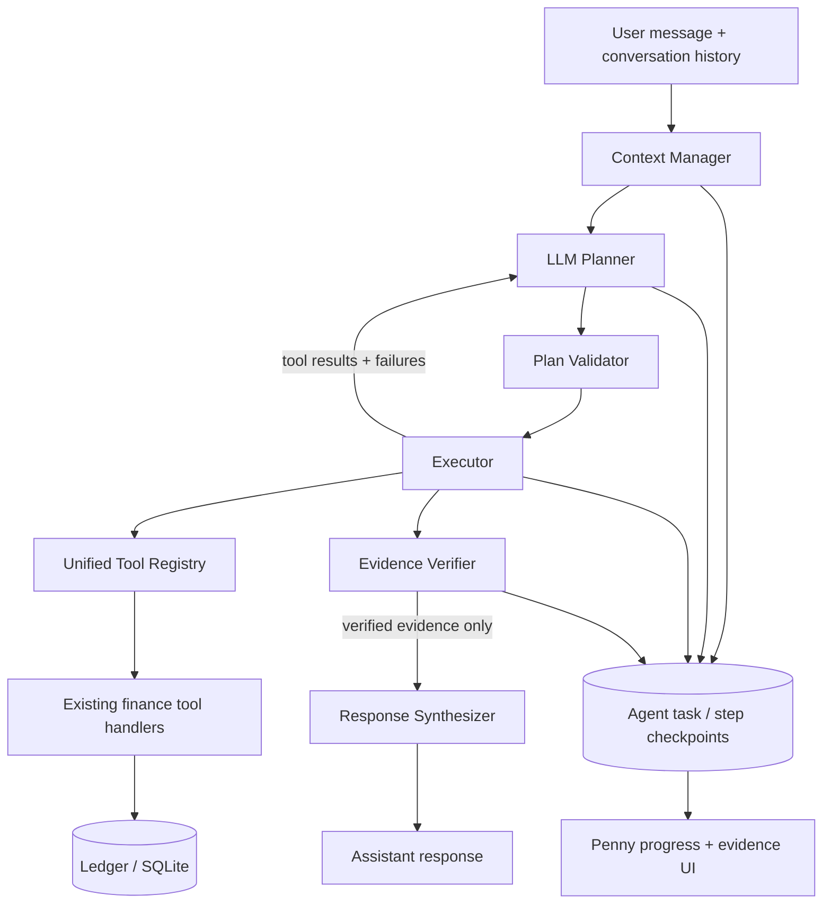

# Penny Agent Runtime Upgrade

This document describes the Penny Agent Runtime included in the current project. The runtime extends the existing application in place: it does not replace the Ledger engine, rebuild the database, or remove the existing MCP / AI-classification flows.

## 1. Runtime architecture



### Responsibilities

- **Tool Registry** is the single source for Penny's OpenAI-compatible and Anthropic tool schemas, Planner catalog, argument validation, policy metadata, and execution dispatch. Existing deterministic local routes remain available for high-confidence one-shot totals/category/date queries. Multi-objective / context-dependent analysis and explicit mutations enter the Agent; simple one-tool read queries may retain the existing low-latency provider tool loop.
- **Context Manager** separates long-term preferences from temporary query constraints. It only inherits previous task constraints for a continuation, preserves distinct scopes for multi-month plans, and provides the current date for relative-period interpretation.
- **Planner** returns a structured plan. It does not execute tools or write to the Ledger.
- **Plan Validator** checks tool existence, schema, date/month formats, dependency references, duplicate steps, cycles, read/write permissions, and mixed read/write dependencies.
- **Executor** runs independent read-only steps concurrently, dependent steps sequentially, enforces per-tool and total limits, records checkpoints, and reports failures instead of converting them to zero values.
- **Verifier** checks that financial facts have read-only evidence, distinguishes verified / no-data / partial / failed / incomplete / pending-proposal states, and validates the evidence IDs used by the response.
- **Response Synthesizer** receives only verifier-approved results. It must return evidence IDs for financial claims.
- **Task persistence** stores the task, generation, step states, plans, result summaries, clarification question, and evidence metadata.
- **Penny UI** polls the task endpoint during execution and displays the current steps. After completion it displays provenance metadata without exposing raw tool results.

## 2. Safety and recovery behavior

1. Proposal tools are hidden from provider tool lists by default. They become available only when the user's message expresses a direct mutation request.
2. Educational questions such as “如何修改分类？” do not authorize a write proposal.
3. A mixed read/write task must complete a read-only query before creating a pending proposal. A single-transaction reclassification must depend on `search_transactions` and its real transaction ID.
4. A proposal is still only a pending confirmation. It is not described as an applied Ledger change.
5. A financial answer must cite one or more valid evidence IDs. Invalid or missing evidence IDs block the answer.
6. Empty query results are represented as `no_data`, not zero spending. `ledger_complete=false` takes precedence over `has_data=false`.
7. Checkpoints are reused only when step ID, tool, exact arguments, and the Ledger snapshot fingerprint match. If the Ledger changes while a financial task is executing, Penny stops instead of mixing results from different snapshots.
8. An interrupted task can resume in a new generation. A changed Ledger snapshot disables old checkpoint reuse.
9. Previous temporary month/category/merchant filters are not inherited into an independent new task. For a follow-up such as “那10月呢”, relevant constraints are carried forward, while the user's newly stated dimension takes precedence.

## 3. Database changes

This increment adds three additive tables to `db/schema.sql`:

- `ai_agent_tasks` — task goal, status, phase, generation, plan, context, result summary, and clarification state.
- `ai_agent_task_steps` — step arguments, dependencies, execution state, result checkpoint, and evidence metadata.
- `ai_agent_preferences` — allowlisted long-term interaction preferences.

`db.init_db()` executes the schema with `CREATE TABLE IF NOT EXISTS`, so the next backend startup creates these tables in an existing database. No existing Ledger table is altered, and no transaction rows are migrated or rewritten.

The snapshot fingerprint is stored in the task `context_json`; raw financial rows are not copied into the fingerprint field. The backend startup marks tasks left in `planning` / `running` by a previous single-process server instance as interrupted and resumable.

## 4. Files changed in this increment

- `backend/ai/chat_service.py`
- `backend/ai/agent/context_manager.py`
- `backend/ai/agent/planner.py`
- `backend/ai/agent/runtime.py`
- `backend/ai/agent/task_state.py`
- `backend/ai/agent/models.py`
- `backend/ai/agent/tool_registry.py`
- `backend/ai/agent/plan_validator.py`
- `backend/ai/agent/verifier.py`
- `backend/ai/agent/synthesizer.py`
- `backend/main.py`
- `db/schema.sql`
- `frontend/src/api/aiChat.ts`
- `frontend/src/components/FloatingPenguin.vue`
- `tests/test_penny_agent_runtime_hardening.py`
- `scripts/test_penny_agent.ps1`
- `docs/PENNY_AGENT_RUNTIME_UPGRADE.md`
- `sample_data/支付宝格式_引擎验收_虚构数据.csv` (restored under the UTF-8 filename referenced by the existing tests; the source archive's filename was encoded incorrectly during extraction)

## 5. Local verification results (2026-11-03)

- Full backend regression suite: **318 passed**, 2 warnings, 0 failed.
- Agent-focused suite: **112 passed**, 2 warnings, 0 failed.
- Python syntax compilation: `python -m compileall -q backend tests` passed.
- Frontend production build: **not verified in this environment**. The source archive does not include `node_modules`; `npm run build` therefore cannot find `vue-tsc`, the offline npm cache does not contain the locked packages, and the online install attempt did not complete. Run `npm ci` and `npm run build` on the development machine before deployment.

## 6. Automated tests

This increment adds a 50-prompt natural-language routing matrix, Agent unit/integration tests, and focused regression tests for:

- multi-month scope preservation;
- not inheriting temporary filters into a new independent task;
- snapshot-aware checkpoint reuse;
- detecting actual Ledger changes;
- incomplete Ledger evidence versus empty data;
- valid evidence-ID enforcement;
- public evidence metadata redaction;
- replanning after a tool failure;
- write-proposal visibility and authorization;
- mixed read/write dependency validation;
- separating read evidence from pending proposals;
- skipping dependent steps when a prerequisite tool fails;
- verifying explicitly named merchants and categories against returned records.

Run the Agent-focused suite:

```powershell
python -m pytest tests/test_z_penny_agent_runtime.py tests/test_penny_agent_runtime_hardening.py -q
```

Run the full backend regression suite:

```powershell
python -m pytest -q
```

Run the frontend type-check and production build:

```powershell
Set-Location frontend
npm ci
npm run build
Set-Location ..
```

Or run the supplied helper script:

```powershell
powershell -ExecutionPolicy Bypass -File .\scripts\test_penny_agent.ps1
```

Agent-only backend tests:

```powershell
powershell -ExecutionPolicy Bypass -File .\scripts\test_penny_agent.ps1 -AgentOnly -SkipFrontend
```

## 7. Manual acceptance test with a configured model

Use a test database or a backed-up copy of your database. Do not import synthetic sample transactions into your only production ledger.

### Case A — multi-dimensional analysis

Prompt:

> 分析2026年9月和10月的消费习惯，比较总支出、分类、商户和大额交易。

Expected:

- Penny plans more than one query step.
- Each month retains its own arguments.
- Independent read-only steps can execute in parallel.
- The final answer distinguishes missing-month data from zero spending.
- The completed task card lists data sources and query scopes.

### Case B — continuous follow-up

After Case A, prompt:

> 那10月餐饮呢？列出具体交易。

Expected:

- The task uses the previous analysis as context.
- The month changes to October; the newly specified category is applied.
- Transaction details come from real transaction rows and are evidence-checked.

### Case C — ambiguous request

Prompt:

> 帮我分析一下。

Expected:

- Penny uses the conversation/page context if it is sufficient.
- Otherwise it asks one concise clarification question.
- The task enters `waiting_for_user` and can resume after the user replies.

### Case D — open-ended financial judgement

Prompt:

> 我最近花钱是不是正常？有什么值得注意的地方？

Expected:

- This enters the Planner rather than a fixed monthly-total route.
- Penny either resolves a grounded period from context or asks for the necessary scope.
- It combines relevant evidence before giving a judgement.

### Case E — mixed query and write request

Prompt:

> 查一下星巴克交易，并把其中一笔改成餐饮。

Expected:

- Penny searches real transactions first.
- The reclassification proposal depends on the real search result.
- A pending confirmation card appears.
- The Ledger is not changed until the user explicitly confirms.

### Case F — simple fast path

Prompt:

> 2026年10月支出多少？

Expected:

- The existing deterministic fast path may answer this one-step question.
- The result still comes from the local Ledger.

## 8. Inspecting a running task

During an Agent request, Penny polls:

```text
GET /api/ai/chat/conversations/{conversation_id}/agent-tasks/latest
```

The conversation detail response also includes `agent_task`. The public response contains step status and provenance metadata only; it does not expose raw transaction query results. The startup recovery helper assumes the normal local single-process Uvicorn deployment; do not run multiple independent worker processes against the same SQLite task store without adding a worker lease/ownership mechanism.

A PowerShell example after replacing the conversation ID:

```powershell
$conversationId = "YOUR_CONVERSATION_ID"
Invoke-RestMethod "http://127.0.0.1:8000/api/ai/chat/conversations/$conversationId/agent-tasks/latest"
```

## 9. Test limitations

Mocked Planner / Executor / Verifier tests do not prove that a live Qwen endpoint will always produce a perfect plan. Real-model end-to-end tests require the user's configured provider, model, API key, and a representative local Ledger. Never put the API key into a test report or share it in chat.
