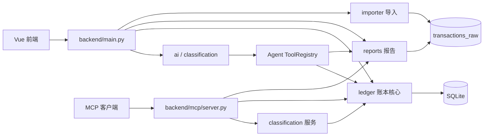
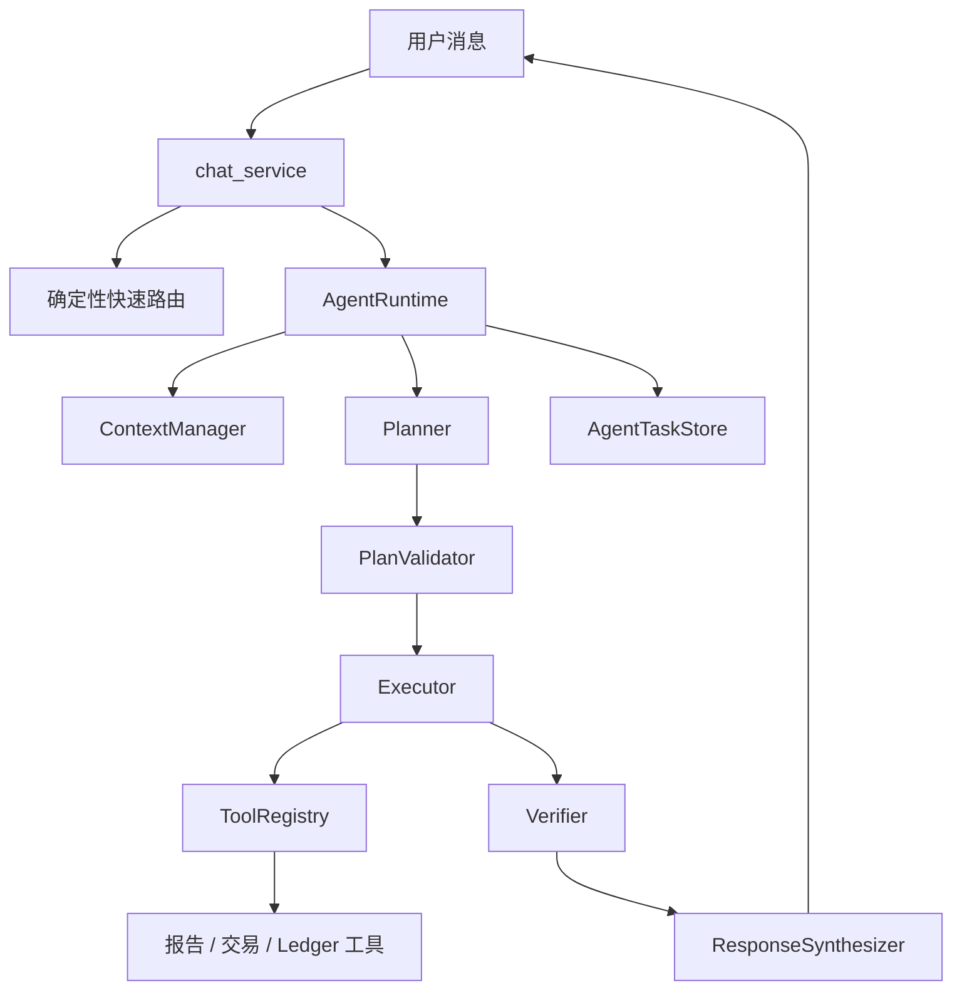

# 团队协作与模块文件说明

> 适用基线：`feature/penny-agent-runtime-v3`，基线提交 `62935cf`
> 编写日期：2026-11-10
> 目的：让队员知道自己负责什么、数据从哪里来、允许改哪些文件、哪些文件必须协商后再改。

## 1. 当前项目是什么

本项目不是单纯的“账单展示页面”，而是由六个可独立分工、通过明确接口连接的模块组成：

1. **智能部分**：Penny 对话、AI 导入分类、历史账单学习、MCP、建议确认与证据校验。
2. **星图部分**：星云账本的可视化、缩放拖拽、节点交互、分类归位和执行状态展示。
3. **账本核心**：整数分金额、退款/转账/外部额度拆分、Ledger 状态、撤销重做与审计。
4. **账单导入**：支付宝/微信文件识别、解析、预览、去重、提交和导入批次记录。
5. **报告与交易管理**：月/周/年报告、分类统计、日历、趋势、交易明细、修正与删除。
6. **工程基础设施**：数据库初始化、API 契约、启动脚本、CI、测试、打包与文档。

当前基线已经验证：后端 `327 passed`、前端 `vue-tsc + vite build` 通过、MCP 27 个工具自检通过。

## 2. 推荐分工

### 2.1 六人或多人团队

| 责任区 | 建议负责人 | 主要交付 | 不应擅自修改 |
|---|---|---|---|
| 智能部分 | AI/Penny 负责人 | Agent、AI 分类、MCP、对话前端 | Ledger 金额算法、导入原始数据结构 |
| 星图部分 | 可视化负责人 | 星图布局、交互、检查器、星图页面 | `ledger/atoms.py` 的金额规则 |
| 账本核心 | Ledger 负责人 | 金额计算、腿结构、操作、审计、迁移 | AI Prompt、具体页面样式 |
| 账单导入 | 导入负责人 | 平台适配器、预览、去重、导入页 | 报告聚合和 Agent 规划逻辑 |
| 报告与交易 | 报告负责人 | 报告接口、账单页、明细页、覆盖修正 | 原始导入解析器、Agent Runtime |
| 集成与质量 | 集成负责人 | `main.py`、共享 schema、CI、脚本、版本发布 | 不直接代替模块负责人改业务算法 |

### 2.2 三人团队

- A：智能部分。
- B：星图部分 + 账本核心。
- C：账单导入 + 报告与交易 + 集成测试。

即使只有三人，也应把“星图显示”和“账本金额算法”当作两个逻辑责任区。画面调整不能顺手改变财务口径。

## 3. 总体调用关系



必须遵守以下边界：

- AI 只能生成计划、证据和待确认建议，不能直接修改 SQLite。
- 分类确认、星图操作和人工修正最终都必须经过 Ledger/业务服务。
- 导入器保存的是可追溯的原始流水；展示分类放在覆盖层或 Ledger 结构中，不回写伪造原始字段。
- 前端只调用 `/api/...`，不能硬编码数据库或模型密钥。
- `backend/main.py` 是 HTTP 集成入口，不应继续堆积业务算法。

## 4. 高冲突共享文件

以下文件多人同时修改最容易产生冲突，原则上由集成负责人合并：

| 文件 | 原因 | 协作规则 |
|---|---|---|
| `backend/main.py` | 所有 HTTP 路由都在这里 | 各模块先在自己的 service 中实现，再由集成负责人接路由 |
| `backend/schemas.py` | 导入、报告、交易、Ledger 共用契约 | 新字段必须同时核对前端类型、测试和兼容性 |
| `db/schema.sql` | 所有模块共享数据库 | 只允许增量迁移；禁止删真实数据表或改旧字段语义 |
| `frontend/src/App.vue` | 全局导航和 Penny 浮窗 | 页面负责人不要在这里写页面业务 |
| `frontend/src/router/index.ts` | 所有页面路由 | 新页面由集成负责人登记，避免路径/参数冲突 |
| `requirements.txt` | 后端与 CI 安装入口 | 加依赖时说明用途并锁定必要的主版本范围 |
| `frontend/package.json`、`package-lock.json` | 前端依赖和构建入口 | 必须一起提交，禁止只改其中一个 |
| `.github/workflows/ci.yml` | PR 合并门禁 | 变更测试命令前先让各模块负责人确认 |

## 5. 智能部分

### 5.1 智能部分流程



### 5.2 智能后端文件

| 文件 | 用途 | 修改时可优化 |
|---|---|---|
| `backend/ai/__init__.py` | AI 包入口。 | 只导出稳定公共接口，避免业务代码依赖内部函数。 |
| `backend/ai/agent/__init__.py` | Agent Runtime 子包入口。 | 只暴露稳定模型或运行时类型，避免跨层引用内部实现。 |
| `backend/ai/chat_service.py` | Penny 对话总服务；保存会话、意图路由、财务工具、模型工具调用、Agent 接入、建议确认。 | 当前约 4266 行，是最高优先级拆分对象。建议拆成 conversation、intent、finance tools、provider loop、action service。 |
| `backend/ai/config.py` | AI Provider 配置读取、校验、加密密钥获取与保存。 | 增加配置版本、供应商能力声明、超时/重试配置；继续保证 API 返回不泄露密钥。 |
| `backend/ai/providers.py` | OpenAI-compatible/千问等 Provider 的 JSON 请求与连接测试。 | 抽象统一 Provider 接口，增加重试、速率限制、结构化错误码和指标。 |
| `backend/ai/schemas.py` | AI HTTP 输入输出 Pydantic 模型。 | 按 settings/import/history/classification 拆文件。 |
| `backend/ai/security.py` | 本地 AI API Key 加密与解密。 | 增加密钥轮换、平台密钥环支持；禁止日志输出解密值。 |
| `backend/ai/import_classifier.py` | 对导入批次分组、规则匹配、特殊交易排除，并调用模型分类。 | 大批量做分块并发、缓存分类树、记录模型成本和失败重试。 |
| `backend/ai/import_workflow.py` | AI 导入会话：创建、校准、多轮消息、分类建议、确认后提交。 | 把数据库访问拆到 store，补充会话过期清理和幂等提交键。 |
| `backend/ai/history_workflow.py` | 对已有历史账单学习，生成分类/分类树建议并确认落账。 | 分离分析、证据提取和写入；为长任务增加进度和取消。 |
| `backend/ai/test_batch_cleanup.py` | 安全识别并隐藏已知虚构测试导入批次。 | 名称容易被 pytest 误解，建议迁到 `backend/maintenance/`。 |
| `backend/ai/agent/models.py` | AgentPlan、Step、StepExecution、VerificationResult 等结构模型。 | 增加显式版本号，保证旧任务 JSON 可迁移。 |
| `backend/ai/agent/context_manager.py` | 区分长期偏好、临时月份/分类约束和多轮上下文。 | 把日期解析独立为 period resolver，增加约束来源追踪。 |
| `backend/ai/agent/planner.py` | 将用户目标和工具目录转换为结构化计划。 | 增加计划预算、降级策略和可测试 Prompt 模板。 |
| `backend/ai/agent/plan_validator.py` | 检查工具、参数、依赖、循环、读写权限和证据要求。 | 将规则分成独立校验器，错误返回稳定 code。 |
| `backend/ai/agent/executor.py` | 并发执行独立只读步骤，按依赖执行后续步骤并记录失败。 | 增加取消令牌、限流、步骤重试和耗时统计。 |
| `backend/ai/agent/tool_registry.py` | Penny 工具定义唯一来源；生成 Provider schema、校验参数、执行分发。 | 工具实现与 schema 分开注册，增加工具版本、权限和审计标签。 |
| `backend/ai/agent/verifier.py` | 判断证据是否完整/无数据/部分失败，并验证回答引用。 | 将金额、日期、商户、分类验证插件化，补跨工具矛盾检测。 |
| `backend/ai/agent/synthesizer.py` | 只使用 verifier 允许的证据组织最终回答。 | 简单回答模板化，减少再次调用模型。 |
| `backend/ai/agent/task_state.py` | 持久化任务、步骤、代际、断点、证据和偏好。 | 增加过期任务归档、分页和状态迁移版本。 |
| `backend/ai/agent/runtime.py` | 串联上下文、规划、校验、执行、验证、合成与恢复。 | 拆出 resume/replan/snapshot policy，增加事件流供前端实时显示。 |
| `backend/classification/models.py` | 模型无关的分类建议结构。 | 增加 schema 版本和更明确的置信度/理由约束。 |
| `backend/classification/__init__.py` | 分类业务包入口和边界说明。 | 只从此处导出稳定 service 接口。 |
| `backend/classification/errors.py` | 分类工作流统一错误码。 | 与 HTTP/MCP 错误映射集中维护。 |
| `backend/classification/store.py` | 分类草案、建议、复核和规则的 SQLite 持久化。 | 引入 repository 接口和批量 SQL。 |
| `backend/classification/service.py` | 待分类、预览、澄清、确认、撤销和规则管理。 | 约 832 行，可按 proposal/rule/batch 拆分；保持唯一落账路径。 |
| `backend/mcp/server.py` | 27 个 MCP 工具，将外部 AI 连接到报告、Ledger 和分类服务。 | 拆为工具组并从业务 schema 生成 MCP schema；MCP 层不复制业务逻辑。 |
| `backend/mcp/__init__.py` | MCP 包说明和入口。 | 仅保留稳定导出。 |
| `prompts/AI分类助手.md` | AI 分类提示词和输出约束。 | Prompt 修改必须带回归样例、版本号和变更记录。 |
| `mcp-config.example.json` | MCP 客户端配置模板。 | 保持占位路径，禁止提交个人绝对路径。 |

### 5.3 智能前端文件

| 文件 | 用途 | 修改时可优化 |
|---|---|---|
| `frontend/src/components/FloatingPenguin.vue` | Penny 浮窗、会话、消息、动作确认、Agent 步骤和证据展示。 | 约 1023 行，应拆窗口壳、消息列表、输入区、任务进度和动作卡片，并将轮询封装为 composable。 |
| `frontend/src/api/aiChat.ts` | 对话、消息、动作确认/拒绝、最新 Agent 任务接口及类型。 | 抽统一 request、错误类型和取消机制。 |
| `frontend/src/api/ai.ts` | AI 设置、AI 导入、分类草案接口及类型。 | 按 settings/import/proposal 拆分。 |
| `frontend/src/api/aiHistory.ts` | 历史学习状态、会话、提交接口及类型。 | 与轮询 composable 结合，统一状态。 |
| `frontend/src/views/AISettingsView.vue` | Provider、Base URL、模型、API Key 和阈值设置。 | 增加供应商预设、字段校验和密钥状态提示。 |
| `frontend/src/views/AIHistoryView.vue` | 历史学习启动、进度、建议审核和提交。 | 拆建议表格与进度组件，大列表分页/虚拟滚动。 |
| `frontend/src/utils/markdown.ts` | Penny 消息的受控 Markdown 渲染。 | 加强链接协议白名单并测试 XSS 边界。 |

### 5.4 智能部分测试

| 文件 | 覆盖重点 |
|---|---|
| `tests/test_ai_chat_companion.py` | 对话基础流程、工具调用和动作确认。 |
| `tests/test_ai_companion_v2.py` | Penny 第二阶段行为与会话能力。 |
| `tests/test_ai_finance_web_v1.py` | AI 设置、密钥保护、AI 导入 HTTP 闭环。 |
| `tests/test_ai_finance_trustworthy_v21.py` | 可信回答、建议与安全边界 V2.1。 |
| `tests/test_ai_finance_trustworthy_v22.py` | 可信回答与工具证据 V2.2。 |
| `tests/test_ai_classification.py` | 分类批次、草案、确认和撤销。 |
| `tests/test_ai_classification_extensions.py` | 澄清、规则、冲突和扩展场景。 |
| `tests/test_ai_workflow_v11.py` | 草案恢复、多轮澄清和 V1.1 工作流。 |
| `tests/test_ai_history_learning.py` | 历史账单学习和确认落账。 |
| `tests/test_ai_history_exclusion_index.py` | 特殊交易排除及行号边界。 |
| `tests/test_ai_qianwen_provider.py` | 千问/OpenAI-compatible 兼容性。 |
| `tests/test_mcp_integration_contract.py` | MCP 工具集合和配置生成契约。 |
| `tests/test_penny_intent_routing.py` | 月份、日期、趋势等意图路由。 |
| `tests/test_penny_semantic_intent.py` | 同义词、比较、近期分析等语义路由。 |
| `tests/test_penny_grounding_regression.py` | 回答必须来自工具结果，阻止编造金额。 |
| `tests/test_penny_agent_continuity.py` | 多轮任务、作用域和证据复用。 |
| `tests/test_penny_agent_runtime_hardening.py` | 快照、权限、失败恢复、证据和并发强化。 |
| `tests/test_z_penny_agent_runtime.py` | Runtime 端到端、工具注册、计划校验和任务持久化。 |

## 6. 星图部分

星图负责“如何看和操作账本”，账本核心负责“怎么算”。二者通过 `/api/ledger/...` 连接。

### 6.1 星图前端文件

| 文件 | 用途 | 修改时可优化 |
|---|---|---|
| `frontend/src/views/StarView.vue` | 星图总编排：筛选、加载树、操作、状态栏、画布和检查器。 | 约 623 行；拆筛选栏、操作栏、历史控制和数据加载 composable。 |
| `frontend/src/components/StarCanvas.vue` | SVG 节点与边渲染、点击和拖拽事件。 | 增加分层渲染、虚拟化和性能基准；不要写账本计算。 |
| `frontend/src/components/StarInspector.vue` | 当前节点/交易详情检查器。 | 按节点类型拆详情卡，增加键盘操作和确认。 |
| `frontend/src/stars/useStarGraph.ts` | Ledger 树转坐标、边、碰撞布局和标题。 | 约 431 行，可拆 layout/geometry/animation，并增加快照测试。 |
| `frontend/src/stars/useStarInteraction.ts` | 缩放、平移、语义缩放和指针交互。 | 统一鼠标/触屏事件，配置缩放边界。 |
| `frontend/src/api/ledger.ts` | Ledger 类型和 tree/op/undo/redo/reset/live API。 | API DTO 与视图模型分开，为错误 code 建前端枚举。 |

### 6.2 星图相关后端和测试

- `backend/main.py` 中 `/api/ledger/live`、`books`、`tree`、`status`、`op`、`undo`、`redo`、`reset` 只做参数接收和服务调用。
- `backend/ledger/service.py` 提供树和操作结果，星图不能绕开它。
- `backend/schemas.py` 的 Ledger 输入模型是契约，修改时同步 `frontend/src/api/ledger.ts`。
- `tests/test_ledger_star.py` 覆盖书本冻结、操作、撤销重做和 HTTP 端点。
- `tests/test_star_live.py` 覆盖实时同步、筛选和删除后的可见性。

## 7. 账本核心

### 7.1 后端文件

| 文件 | 用途 | 修改时可优化 |
|---|---|---|
| `backend/ledger/__init__.py` | Ledger 包入口。 | 只导出 service 级公共能力。 |
| `backend/ledger/amount.py` | 金额转整数分、转展示金额、NET 运算。 | 保持纯函数，增加性质测试，不引入浮点运算。 |
| `backend/ledger/atoms.py` | 交易转会计腿；退款、内部转账、外部额度和特殊交易。 | 约 757 行，可拆 refund/transfer/funding；拆分前补性质测试。 |
| `backend/ledger/invariants.py` | I1-I6、净额幂等、树结构和金额守恒校验。 | 每条不变量独立命名并返回稳定错误 code。 |
| `backend/ledger/loader.py` | 读取 book、state、legs 和原始交易事实。 | 减少重复查询，集中 row-to-domain；读取层不修复坏数据。 |
| `backend/ledger/ops.py` | ADD/NET、节点重分配、split/unsplit 等状态操作。 | 使用命令对象减少分支，保持可撤销。 |
| `backend/ledger/store.py` | 保存书本、腿结构、修订历史和实时成员。 | 批量写入、明确事务边界、增加 revision 元数据。 |
| `backend/ledger/service.py` | 唯一业务入口：创建/同步/读取/操作/历史/迁移。 | 约 555 行，可按 query/command/migration 拆分；写操作先校验再提交。 |
| `backend/ledger/migrate.py` | 命令行执行 Ledger Legs 迁移。 | 增加 dry-run 和迁移报告。 |
| `backend/ledger/errors.py` | Ledger 错误码与异常。 | 保持错误 code 稳定，HTTP/MCP/前端都依赖。 |

### 7.2 账本测试

| 文件 | 覆盖重点 |
|---|---|
| `tests/test_ledger_atoms.py` | 原子腿、退款、外部资金和非法事实。 |
| `tests/test_ledger_atoms_engine.py` | 原子腿与日期过滤下的引擎行为。 |
| `tests/test_ledger_engine_v3.py` | V3 主验收、随机操作、不变量和特殊交易。 |
| `tests/test_ledger_legs_persistence.py` | `ledger_legs` 持久化、迁移和损坏检测。 |
| `tests/test_ledger_leg_authority.py` | `ledger_legs` 为结构唯一权威，旧 placements 退役。 |
| `tests/test_ledger_star.py` | Ledger 与星图操作契约。 |

任何金额算法变化必须同时提交“失败前测试 + 修复 + 验收说明”，不能只凭页面看起来正确。

## 8. 账单导入

### 8.1 后端文件

| 文件 | 用途 | 修改时可优化 |
|---|---|---|
| `backend/importer/base.py` | 统一 `Row`、解析问题、金额/时间/方向标准化和状态过滤。 | 稳定平台无关契约；增加货币、时区字段。 |
| `backend/importer/alipay.py` | 支付宝 CSV/XLSX/ZIP 解码、表头定位、尾部过滤和行解析。 | 容器解压与行解析分层；增加格式版本检测。 |
| `backend/importer/wechat.py` | 微信 Excel 表头查找和行解析。 | 增加不同导出版本 fixture，减少列位置假设。 |
| `backend/importer/__init__.py` | 平台检测、解析、去重、批次写入和导入总入口。 | 拆 detector/service/store；明确重复指纹和跳过原因。 |
| `backend/main.py` 的 import 路由 | 暂存上传、预览、提交和导入历史。 | 抽 `routers/imports.py`，限制文件大小和临时文件生命周期。 |
| `backend/schemas.py` 的 Import 模型 | 预览、提交和历史响应契约。 | 拆到 `schemas/imports.py`，同步前端类型。 |

### 8.2 前端文件

| 文件 | 用途 | 修改时可优化 |
|---|---|---|
| `frontend/src/views/ImportView.vue` | 拖拽/选择、密码、机械与 AI 导入预览、确认和历史。 | 约 629 行，应拆 DropZone、PreviewTable、AIReview、History；增加进度和取消。 |
| `frontend/src/api/imports.ts` | 机械导入 preview/commit/history API。 | 统一上传错误、AbortSignal 和进度回调。 |
| `frontend/src/types/import.ts` | 机械导入前端类型。 | 由后端 schema 生成，避免字段漂移。 |
| `frontend/src/api/ai.ts` | AI 导入 analyze/calibrate/commit。 | 与机械导入共享上传封装，但不能混淆提交入口。 |

### 8.3 测试与样例

| 文件 | 用途 |
|---|---|
| `tests/test_alipay_password.py` | 加密 ZIP 密码和错误处理。 |
| `tests/test_importer_excel_formats.py` | 微信/支付宝 Excel 格式与表头变化。 |
| `tests/test_importer_review.py` | 预览、去重、提交、删除和复核。 |
| `sample_data/支付宝模拟账单.csv` | 常规虚构样例。 |
| `sample_data/支付宝模拟账单.zip` | ZIP 虚构样例。 |
| `sample_data/支付宝异常账单_模拟.csv` | 异常行和尾部说明样例。 |
| `sample_data/支付宝格式_引擎验收_虚构数据.csv` | Ledger V3 验收输入。 |
| `private_input/.gitignore` | 真实账单隔离目录占位；真实账单绝不能提交。 |

## 9. 报告与交易管理

### 9.1 后端报告文件

| 文件 | 用途 | 修改时可优化 |
|---|---|---|
| `backend/reports/__init__.py` | 汇总导出报告函数。 | 保持薄入口。 |
| `backend/reports/_common.py` | 周/月/年边界、SQL 条件、方向、百分比和行映射。 | 统一 period value 类型，避免重复日期解析。 |
| `backend/reports/summary.py` | 当前期总额、笔数、上期对比。 | 统一比较期计算，补空数据语义。 |
| `backend/reports/calendar.py` | 按日聚合金额和笔数。 | 扩展周/年之前先明确输出契约。 |
| `backend/reports/trend.py` | 最近 N 期趋势。 | 一次 SQL 聚合替代循环查询，支持明确起止期。 |
| `backend/reports/category.py` | 按大类/小类聚合。 | 分类树读取与金额聚合分离。 |
| `backend/reports/method.py` | 按支付方式聚合。 | 标准化支付方式和未知值。 |
| `backend/reports/income_rank.py` | 收入来源排行。 | 支持分页、并列排名和阈值。 |
| `backend/reports/transactions.py` | 交易分页、筛选和待分类列表。 | 可组合 query object；大数据改游标分页。 |
| `backend/overrides.py` | 人工覆盖、详情、清除修正和逻辑删除。 | 删除与覆盖审计统一，增加恢复删除。 |

### 9.2 前端报告文件

| 文件 | 用途 | 修改时可优化 |
|---|---|---|
| `frontend/src/views/BillView.vue` | 周/月/年、收入/支出、概览、趋势、日历和分类报告。 | 约 445 行；拆图表卡片和 period selector。 |
| `frontend/src/views/TransactionsView.vue` | 交易列表、分页、筛选、日历检索和删除。 | 筛选写入 URL，增加批量操作和删除恢复提示。 |
| `frontend/src/views/TxEditView.vue` | 单笔详情和人工覆盖修正。 | 增加脏表单提示、字段错误和版本冲突处理。 |
| `frontend/src/api/reports.ts` | 报告、日历、交易、详情和删除 API。 | 分成 reports/transactions API，统一请求层。 |
| `frontend/src/types/report.ts` | 报告、交易、覆盖和详情类型。 | 考虑由 OpenAPI 生成。 |

## 10. 工程基础设施与共享文件

### 10.1 后端与数据库入口

| 文件 | 用途 | 修改时可优化 |
|---|---|---|
| `backend/main.py` | FastAPI、异常映射和所有 HTTP 路由。 | 约 651 行，按 ledger/imports/ai/reports/transactions 拆 router。 |
| `backend/db.py` | schema 初始化、连接、事务和统计。 | 使用显式 migration version。 |
| `backend/schemas.py` | HTTP 输入输出模型集合。 | 按领域拆包，并生成前端类型。 |
| `backend/__init__.py` | 后端包标记。 | 不放业务逻辑。 |
| `db/schema.sql` | 完整 SQLite 基线：原始流水、覆盖、导入、Ledger、AI、聊天和 Agent。 | 约 602 行；新增结构使用编号迁移，schema 保留为新库快照。 |
| `db/schema_addition_ai_classification.sql` | 旧库补 AI 分类表。 | 标记适用版本并交 migration runner 管理。 |
| `db/schema_addition_ledger_legs.sql` | 旧库补 Ledger Legs。 | 增加迁移记录和重复执行验收。 |

表归属：

- 导入：`platforms`、`transactions_raw`、`import_batches`。
- 人工修正：`tx_overrides`、`tx_deletions`。
- Ledger：`ledger_books`、`ledger_book_tx`、`ledger_nodes`、`ledger_legs`、`ledger_history`；`ledger_placements` 为迁移遗留。
- AI 分类：`ai_classification_*`、`ai_provider_config`。
- AI 导入/历史：`ai_import_*`、`ai_history_learning_*`。
- Penny：`ai_chat_*`、`ai_agent_tasks`、`ai_agent_task_steps`、`ai_agent_preferences`。

### 10.2 前端基础文件

| 文件 | 用途 | 修改时可优化 |
|---|---|---|
| `frontend/src/main.ts` | 创建 Vue，注册 Pinia/Router，加载样式。 | 保持稳定，不写业务。 |
| `frontend/src/App.vue` | 全局导航、路由出口和 Penny 浮窗。 | 移动端导航改折叠，业务状态下沉。 |
| `frontend/src/router/index.ts` | 页面路由和账单页 query 契约。 | 默认月份不要硬编码，改当前日期或最近数据。 |
| `frontend/src/styles/variables.css` | 全局颜色、字体、背景和布局变量。 | 建完整 design token，减少重复颜色。 |
| `frontend/src/vite-env.d.ts` | Vite TS 环境声明。 | 通常无需修改。 |
| `frontend/index.html` | Vite HTML 入口。 | 补 favicon、语言和 meta。 |
| `frontend/package.json` | 前端依赖和命令。 | 加 lint/test；删依赖前先构建验证。 |
| `frontend/package-lock.json` | 依赖锁定。 | 必须与 package.json 一起提交，禁止手改。 |
| `frontend/tsconfig.json` | TypeScript 配置。 | 逐步开启更严格检查。 |
| `frontend/vite.config.ts` | Vue 插件、别名、端口和 `/api` 代理。 | 增加分包策略，解决主 bundle 超 500 kB。 |

### 10.3 根目录和 CI

| 文件 | 用途 | 修改时可优化 |
|---|---|---|
| `.github/workflows/ci.yml` | PR 自动跑 pytest、MCP selftest 和前端 build。 | 注释仍写旧的 81 例/14 工具和已删除脚本，应更新；命令仍有效。 |
| `.gitignore` | 隔离数据库、真实账单、环境、依赖、密钥和缓存。 | 新工具产生缓存时及时补充，禁止放宽真实数据规则。 |
| `README.md` | 项目能力、启动、MCP 和进度总说明。 | 历史记录移入 docs，根 README 聚焦当前运行。 |
| `requirements.txt` | Python 运行和测试依赖。 | 运行依赖与 dev/test 依赖拆开，评估 `httpx2`。 |
| `一键启动财务助手.cmd` | 缺环境时 setup，之后后台启动。 | 输出健康检查地址和失败日志位置。 |
| `一键停止财务助手.cmd` | 调停止脚本终止后台进程。 | 停止后校验端口是否释放。 |

### 10.4 脚本逐项说明

| 文件 | 用途 | 优化建议 |
|---|---|---|
| `scripts/setup.ps1` | 创建 `.venv`，安装后端和前端依赖。 | 增加版本检查和镜像参数。 |
| `scripts/launch-app.ps1` | 后台启动、记录 PID、健康检查和打开浏览器。 | 与 start-all 合并重复逻辑。 |
| `scripts/start-all.ps1` | 幂等启动整套应用。 | 约 262 行，复用公共启动函数。 |
| `scripts/start-backend.ps1` | 单独启动 FastAPI。 | 增加日志级别参数。 |
| `scripts/start-frontend.ps1` | 单独启动 Vite 并检查依赖。 | 避免隐式安装，改明确提示。 |
| `scripts/stop-app.ps1` | 按 PID 状态停止进程树。 | 加端口兜底但避免误杀。 |
| `scripts/check.ps1` | 检查环境、服务和接口。 | 加 MCP/迁移状态摘要。 |
| `scripts/check_mcp_connection.py` | 真实 stdio MCP 握手并核对工具。 | 工具清单从公共常量导入。 |
| `scripts/print_mcp_config.py` | 生成本机 MCP 配置。 | 增加客户端模板和路径检查。 |
| `scripts/test_penny_agent.ps1` | 运行 Penny 专项测试和可选前端构建。 | 接入 CI matrix。 |
| `scripts/verify_ledger_engine.py` | 虚构账单 + 临时库验收 Ledger V3。 | 输出 JSON 报告。 |
| `scripts/verify_ledger_engine.cmd` | Windows 双击运行 Ledger 验收。 | 保持薄包装。 |
| `scripts/start_import_demo_isolated.py` | 临时数据库启动隔离导入演示。 | 支持端口参数。 |
| `scripts/verify_import_flow_private_wechat.py` | 私有微信 + 虚构支付宝临时库验证。 | 输入路径参数化，禁止提交真实文件。 |
| `scripts/verify_import_flow_real_both.py` | 双平台真实账单临时库验证。 | 与上一脚本合并公共框架。 |
| `scripts/cleanup_test_import_batch.py` | 安全隐藏已知测试批次。 | 改通用 maintenance CLI，保留 dry-run。 |
| `scripts/package-release.ps1` | 排除环境、数据库和密钥后打包。 | 文件名仍固定 V3.1，改从 Git tag/参数取版本。 |

## 11. 文档文件如何使用

- `docs/README.md`：文档入口。
- `docs/PENNY_AGENT_RUNTIME_UPGRADE.md`：Penny Agent 设计与安全行为。
- `docs/MCP客户端接入与验证.md`：外部 AI 接入 MCP。
- `docs/使用用户自己的AI.md`：用户自己的 AI 使用流程。
- `docs/使用/网页AI智能导入.md`：网页内 AI 导入操作。
- `docs/使用/AI历史账单学习.md`：历史学习操作。
- `docs/验收/*`：各阶段验收依据，改行为时同步更新。
- `docs/设计/第二轮/*`：当前账本代数、AI 插件、前端和契约设计。
- `docs/设计/第一轮/*`：早期需求背景，不作为当前代码唯一事实。
- `docs/归档/v0/*`：历史材料，只供追溯。

## 12. 推荐优化顺序

### 第一优先级：降低多人冲突

1. `backend/main.py` 拆领域 router。
2. `backend/schemas.py` 拆领域 schema。
3. `backend/ai/chat_service.py` 拆对话、路由、工具和动作服务。
4. `FloatingPenguin.vue`、`ImportView.vue`、`StarView.vue` 拆组件和 composable。

### 第二优先级：契约自动化

1. 从 OpenAPI 生成前端 DTO。
2. MCP schema 从 ToolRegistry/业务 schema 生成。
3. 数据库引入 migration version。
4. CI 增加 lint、前端单测和 migration test。

### 第三优先级：性能和体验

1. Vite 手动分包，降低主 bundle。
2. 星图大数据虚拟化与布局性能测试。
3. 导入/历史学习增加进度、取消和后台任务队列。
4. 交易列表改游标分页，报告聚合减少重复 SQL。

## 13. 分支与 PR 规则

建议分支：

```text
feature/ai-xxx
feature/star-xxx
feature/ledger-xxx
feature/import-xxx
feature/report-xxx
chore/ci-or-docs-xxx
```

每个 PR 应做到：

1. 只解决一个明确模块任务。
2. 写明改动文件、接口变化、数据库变化和回滚方法。
3. 后端执行 `python -m pytest -q`。
4. AI/MCP 改动执行 `python -m backend.mcp.server --selftest`。
5. 前端执行 `npm run build`。
6. 不提交 `.venv`、`node_modules`、`dist`、`.env`、API Key、真实账单和 `db/bills.db`。
7. 修改共享热点时，在 PR 描述中通知对应负责人。

## 14. 开始任务前的快速判断

- 改“Penny 怎么理解和回答” → 智能部分。
- 改“AI 如何生成分类建议” → 智能部分 + classification。
- 改“星图怎么画、怎么拖、怎么缩放” → 星图部分。
- 改“退款/转账/金额怎么算” → 账本核心。
- 改“支付宝/微信文件怎么读、重复怎么判” → 账单导入。
- 改“月报、分类图、交易列表显示什么” → 报告与交易。
- 改路由、共享 schema、数据库结构、启动和 CI → 集成负责人协调。

如果一个任务横跨三个以上责任区，应先写接口契约，再拆成多个 PR，不要让一个人直接在所有层同时大改。
